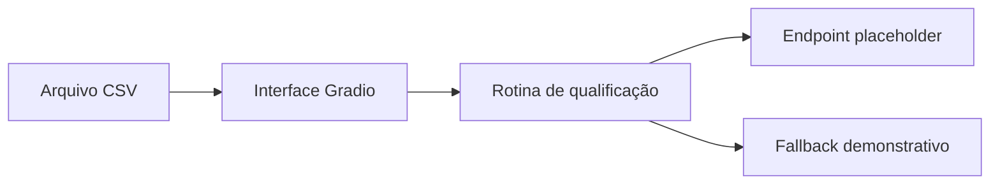

 | [](LICENSE) | [](https://github.com/sponsors/felipetjmg1-bit)

# Qualificação de Leads — Protótipo Python

## Visão geral

Protótipo pequeno em Python para qualificação de leads a partir de CSV. O README descreve objetivos de soberania tecnológica, privacidade e eficiência, mas o código visível implementa uma interface Gradio e rotinas de demonstração; não comprova processamento nacional, blockchain ou operação de IA soberana. A rotina principal usa um endpoint placeholder, não uma integração funcional demonstrada.

## Objetivo e valor

**Problema/escopo:** Protótipo Python com interface Gradio para qualificação de leads a partir de CSV; integração de IA demonstrativa e ainda configurável.

**Valor verificável hoje:** o repositório torna explícitos seus artefatos, interfaces e limitações para que mantenedores e contribuidores possam avaliar o que existe sem confundir demonstração, proposta e produção.

## Arquitetura e tecnologias

Arquitetura formal não documentada. No código, app.py cria uma interface Gradio de upload de CSV e chama automate_lead_qualification em lead_automation.py; essa função lê o CSV com pandas e tenta fazer POST para https://api.example.com/ai-qualifier, com score padrão 0.5 em caso de exceção. demo_efficiency.py é uma demonstração separada baseada em regras locais; não demonstra implantação ou detecção de cluster K3s, nem integração de modelo. Não há evidência no código visível de arquitetura distribuída, blockchain ou RAG.



- Python (linguagem indicada nos metadados e nos scripts).
- pandas e requests são as dependências listadas em requirements.txt.
- Gradio é importado e usado por app.py, mas não consta em requirements.txt.
- JSON e time aparecem em scripts como módulos da biblioteca padrão; parte dos imports parece não utilizada.

## Início rápido

Os comandos abaixo refletem instruções, manifestos ou pontos de entrada presentes no repositório. Dependências externas, segredos e serviços estão indicados quando aplicável; a presença de um comando não equivale a uma execução validada.

1. O README não documenta comandos de instalação ou execução.
2. requirements.txt contém somente pandas e requests. `pip install -r requirements.txt` instala essas dependências declaradas, mas não satisfaz o import de gradio em app.py.
3. app.py termina com iface.launch(), então `python app.py` é o comando indicado pelo código para iniciar a interface, desde que Gradio e demais dependências estejam instalados; execução não foi testada e a instalação declarada é incompleta para esse script.


## Exemplo de uso


Exemplo de CSV sintético para a interface (os cabeçalhos correspondem aos campos lidos pelo código):

```csv
company_description,contact_notes
"Empresa de logística com 50 funcionários","Solicitou uma demonstração do produto"
```

A chamada de qualificação ainda usa um endpoint placeholder; esse exemplo não produz uma integração real de IA.

## Estado e limitações

**Maturidade indicada:** Demonstração.

- Não apresentar como serviço de IA pronto para uso: lead_automation.py envia requisições a api.example.com, explicitamente placeholder, e usa score 0.5 como fallback em erro.
- demo_efficiency.py é identificada pelo próprio código como simulação; api_key não é usada na heurística e a mensagem sobre K3s não comprova detecção nem execução em cluster.
- A proposta menciona resultados quantitativos e controles de segurança que não são comprovados pela implementação visível; não repetir como resultados verificados.
- O README menciona blockchain e processamento/privacidade soberanos, mas não há implementação correspondente visível nos seis arquivos.

## Contribuição

Leia [CONTRIBUTING.md](CONTRIBUTING.md) antes de abrir uma issue ou pull request. Para reportes de segurança, siga a orientação específica do repositório, se houver.

## Licença

Este repositório está licenciado sob **MIT**; consulte [LICENSE](LICENSE).

## Patrocínio e apoio

O desenvolvimento aberto exige tempo para manutenção, documentação, testes, revisão de contribuições e resposta a issues. Se este projeto for útil, considere apoiar a continuidade pelo [GitHub Sponsors](https://github.com/sponsors/felipetjmg1-bit). O apoio não representa promessa de funcionalidades, prazo de entrega ou suporte comercial.

[](https://github.com/sponsors/felipetjmg1-bit)
